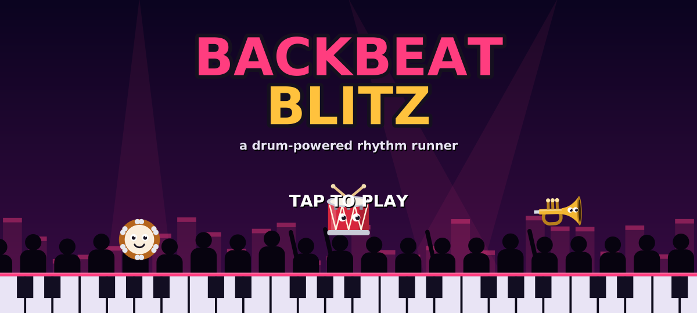
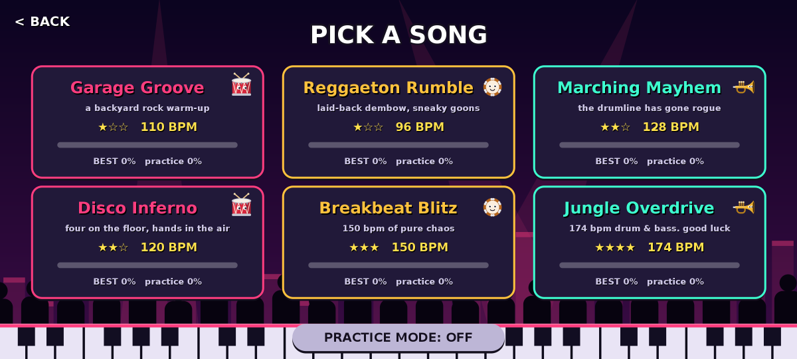
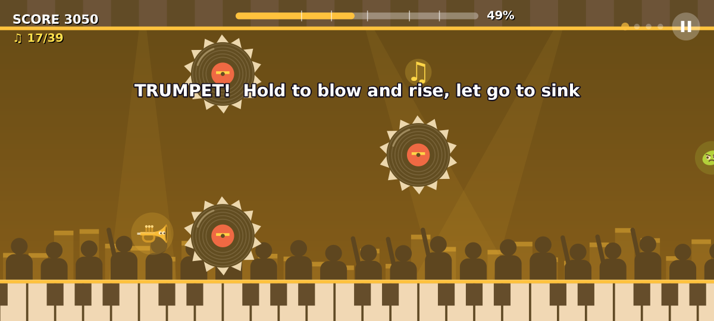
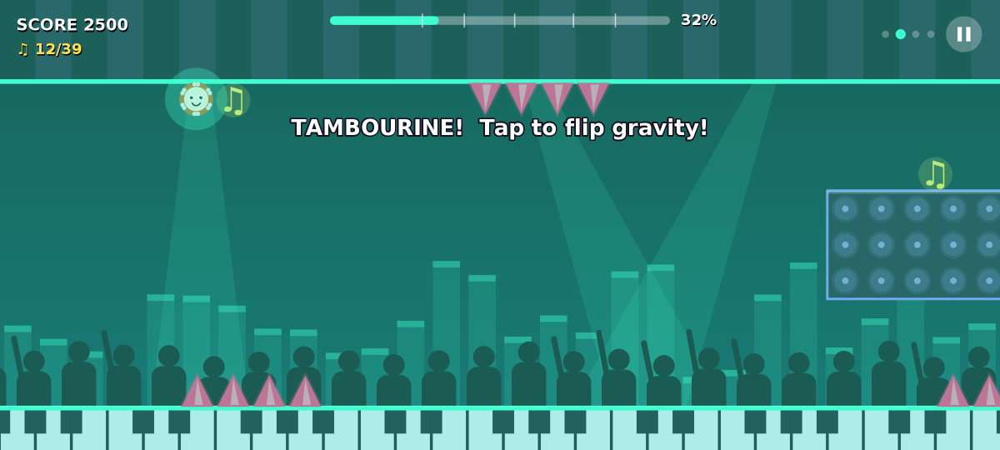

# Backbeat Blitz 🥁

An Android rhythm runner where **you are the instrument**, the level is the song, and every jump is a drum hit.



## Install

Download **[`BackbeatBlitz.apk`](BackbeatBlitz.apk)** to your phone, open it, and allow "install unknown apps" when Android asks.
Works on Android 5.0+ and plays in landscape.

## How it plays

The world is built on the music grid. One block is a 16th note, one beat is 4 blocks, and **a drum jump lasts exactly one beat**.
If you jump on the beat, you land on the beat. The bass, beat and fills you hear tell you when to jump.

| You are… | Controls | The band adds… |
|---|---|---|
| **Snare Drum** 🥁 | tap or hold to jump | full drum kit |
| **Trumpet** 🎺 | hold to blow and rise, let go to sink | a brass lead melody |
| **Tambourine** 🪘 | tap to flip gravity | jingles and claps |

Fly through the **instrument portals** to switch. The music changes with you.

### Things that will hurt you
- **Sharps**: pink spikes on the floor and ceiling
- **Noise Goons**: grumpy guys with megaphones walking at you. **Land on their heads** as the drum to stomp them (*BAP!*, bonus points)
- **Sour Notes**: angry green notes bobbing up and down on the beat
- **Vinyl Saws**: spinning records with teeth
- **Speaker stacks**: you can land on top, but don't run into the side

### Things that help
- **Cymbals** (golden discs): tap while touching one to jump again in mid-air
- **Drum Pads** (yellow): launch you extra high
- **♫ Notes**: collect them for points

### Leeway
- **Input buffer:** a tap up to 90 ms before you land, or before you reach a cymbal, still counts.
- **Coyote time:** you can still jump 60 ms after running off a ledge.
- Spikes, saws, goons and sour notes have hitboxes a little smaller than they look.

### Scoring
Jumps, flips and cymbal hits that land within ~55 ms of the beat score **PERFECT**, within ~110 ms **GREAT**.
Chain them for a **beat combo** score multiplier.
**Practice mode** (toggle it on the song list) respawns you at the last instrument change.

### Songs
| | Song | BPM | Style |
|---|---|---|---|
| ★ | Garage Groove | 110 | backyard rock |
| ★ | Reggaeton Rumble | 96 | laid-back dembow |
| ★★ | Marching Mayhem | 128 | drumline funk with cowbell |
| ★★ | Disco Inferno | 120 | four-on-the-floor disco |
| ★★★ | Breakbeat Blitz | 150 | breakbeat chaos |
| ★★★★ | Jungle Overdrive | 174 | drum & bass |






## Under the hood
- Pure Java and Android Canvas, no engine and no libraries. The APK is about 100 KB.
- **No audio files.** Every drum, cymbal, bass note and trumpet note is synthesized when the app starts. A step sequencer sends them to `AudioTrack` with sample-accurate timing.
- The game clock comes from the audio hardware's playback position, so the visuals stay in sync with what you hear.
- The physics constants come from each song's tempo (`Sim.java`), so every song feels the same at its own speed.
- `tools/Solver.java` is a brute-force bot. It proves every level, from every practice checkpoint, can be beaten even when inputs can only change every 1/12 s, whatever the input phase. It runs on every build.

## Building
No Gradle or Google SDK download needed. It uses the Ubuntu/Debian packages:

```sh
sudo apt-get install android-sdk-platform-23 aapt zipalign apksigner dalvik-exchange
./build.sh          # runs the level solver, then builds and signs BackbeatBlitz.apk
```

`debug.keystore` is a throwaway debug key (password `android`). It stays the same between builds, so a new APK installs over an old one.

`tools/shim/` is a small Java2D stand-in for `android.graphics`. With it the real game code can render screenshots and play a full level on a desktop JVM. That is how the screenshots above were made.
