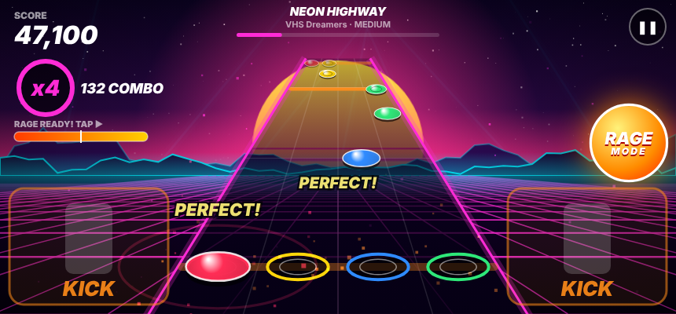
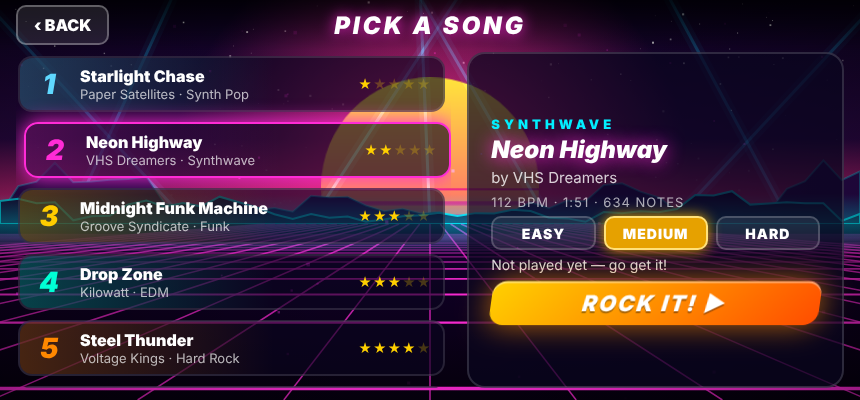
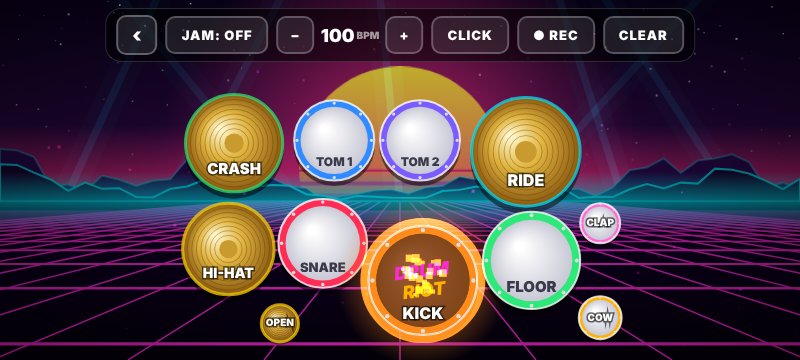
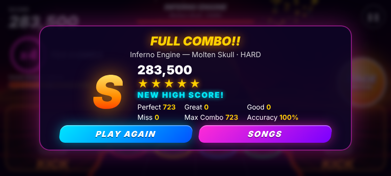

# 🥁 DRUM RIOT

A rhythm drum game for Android. Notes fly down a neon highway and you smash the pads in time, Rock Band style. There's also a **Free Play** drum kit for jamming.

**APK:** [`dist/DrumRiot.apk`](dist/DrumRiot.apk) (about 100 KB, works offline, Android 5.0+)



## Features

### 🎸 Song mode
- A 4-lane highway: **red snare, yellow hi-hat/ride, blue toms, green crash/floor tom**. Orange bars are **kick** notes, which you hit with the big KICK pads on either side.
- Tap anywhere in a lane column to hit it. Multi-touch works, so you can drum with both thumbs.
- Timing ratings are Perfect, Great and Good. A combo raises the multiplier (x2, x3, x4), and every 50-note streak gets a callout.
- **RAGE MODE**: Perfect hits fill the rage meter. At half full, tap the RAGE button for **double points**. The whole world turns gold and lasers go off.
- Three difficulties (Easy, Medium, Hard) are generated from the same drum part.
- Results screen with a grade (S to D), 1–5 stars, accuracy, max combo and saved high scores.

### 🎶 7 original songs
All music is synthesized live in code, so there are no audio files and no copyrighted songs.

**Back Alley Bop** is a swing tune where you, the drummer, lead. It opens with a drum intro, then the band plays the melody with walking bass, piano and sax. After that you trade 4-bar breaks with the band and take a full drum solo.

| # | Song | Artist | Style | BPM |
|---|------|--------|-------|-----|
| 1 | Starlight Chase | Paper Satellites | Synth Pop | 96 |
| 2 | Neon Highway | VHS Dreamers | Synthwave | 112 |
| 3 | Midnight Funk Machine | Groove Syndicate | Funk | 104 |
| 4 | Drop Zone | Kilowatt | EDM | 128 |
| 5 | Back Alley Bop | The Brushfire Quartet | Jazz Swing, drum lead | 150 |
| 6 | Steel Thunder | Voltage Kings | Hard Rock | 138 |
| 7 | Inferno Engine | Molten Skull | Metal | 150 |

The backing band (bass, synths, distorted guitars, leads) plays the song. **The drums only sound when you hit them**, so if you miss, the drum part goes quiet.

### 🥁 Free Play
- 11 pads: kick, snare, hi-hat, open hat, 2 toms, floor tom, crash, ride, clap and cowbell.
- **JAM**: loop the backing track from any song and drum along.
- **CLICK**: a metronome you can set from 50 to 220 BPM.
- **REC / LOOP**: record a 2-bar beat. It keeps looping and you can layer more hits on top (overdub).

### 🌆 Background
An animated synthwave world reacts to the music: a striped sun, a scrolling neon grid, mountains, a starfield, sweeping lasers and embers. Each song has its own color theme, and everything pulses with the beat.

### ⚙ Settings
Music and drum volume, note speed, timing offset (latency calibration), Auto Kick (the computer plays the kick drum), vibration, and battery saver graphics.

## Install
1. Copy `dist/DrumRiot.apk` to your phone, or download it from GitHub.
2. Tap it and allow **Install unknown apps** if Android asks.
3. Open the app and turn your phone sideways.

## Build it yourself
No Android Studio or Gradle needed. On Ubuntu or Debian:
```bash
sudo apt install aapt apksigner dalvik-exchange zipalign android-sdk-platform-23 default-jdk python3-pil
./build.sh            # -> dist/DrumRiot.apk
```
To test the game in a desktop browser, open `app/assets/index.html`. The keys are **D F J K** for the lanes, **Space** for kick and **Enter** for Rage. In Free Play the keys are Q W E R A S D F Z C and Space.

## Layout
```
app/assets/   the game (HTML5 canvas + Web Audio)
  audio.js    synth engine, synthesized drum kit, sequencer
  songs.js    songs, drum patterns, chart and difficulty generator
  game.js     gameplay, visuals, menus, free play
app/src/      Android WebView wrapper (MainActivity.java)
build.sh      builds and signs the APK
```
`debug.keystore` is a throwaway debug signing key (password `android`). It's committed so future builds can install as updates over the old version.

| Song select | Free Play | Results |
|---|---|---|
|  |  |  |
